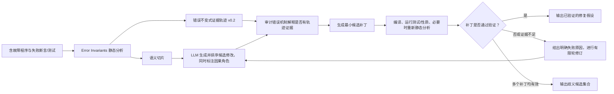

# V2 方法中文说明稿：切片优先、角色区分、反事实验证的 Error Invariant 辅助方法

## 一、为什么需要修改原方法

原方案希望让大语言模型直接阅读 Error Invariant（错误不变式）轨迹，并据此比单纯阅读源码更准确地定位根因。G1–G6 试验表明，这一设想不能直接成立。

在当前两个能够完成静态分析、因而可以公平比较的案例中：

- 仅向模型提供源码，以及提供“源码 + 语义切片”，定位 Top-1 均为 100%；
- 直接提供原始 Error Invariant Map 或结构化轨迹，定位 Top-1 为 50%；
- 结构化轨迹 v0.2 将解释的证据合规率从 2/6 提升到 6/6，但没有提升根因排序。

原因并非只是提示词不够好，而是两类信息的含义不同：Error Invariant 描述的是“程序如何到达错误状态”的**错误传播机制**，但在缺少规格、完整测试或可信修复版本时，它不一定能唯一说明“开发者最初写错了哪一处”。例如，错误初始化与循环中错误更新，都可能导致同一个断言失败。

因此，V2 不再把错误不变式轨迹当作根因排序器，而是将其定位为可核查的机制证据；根因候选由源码和语义切片提出，再通过可执行的反事实验证形成闭环。

## 二、V2 的核心问题

**研究问题：** 能否让 LLM 基于“源码 + 语义切片”生成并排序故障候选，再利用 Error Invariant 轨迹审计其错误机制解释，并通过最小补丁的反事实执行验证，输出可追溯、可验证且不过度声称唯一根因的修复假设？

V2 的目标不是让模型在证据不足时强行给出唯一答案，而是给出一组经过验证的修复候选；若多个候选都能消除故障，系统应明确报告这种歧义。

## 三、方法整体流程



### 1. 构建静态证据

首先运行复现的 Dimovski Error Invariants 工具。它产生两类产物：

- **语义切片**：提取与失败断言有关的关键语句和依赖关系，作为 LLM 寻找故障候选的主要上下文；
- **证据轨迹 v0.2**：保存错误路径上与错误变量有关的状态、位置和写操作，作为解释审计依据。

v0.2 的关键修正是：即使某个位置的抽象不变式为 `top`，只要它直接写入错误相关变量，也必须保留。例如，初始化语句可能在抽象域中信息较弱，却仍是一个真实的故障候选。

若静态工具崩溃、超时或无法映射程序位置，必须明确记录为“分析不可用”；不能把它当作定位失败，也不能悄悄从统计中删除。

### 2. 生成候选并区分因果角色

LLM 的主要输入是故障源码和语义切片。它不只输出“最可疑的行”，还需要针对每个相关语句区分其角色：

| 角色 | 含义 |
|---|---|
| `fault_origin`（故障起因） | 候选的开发者错误，即建议修改的位置和方式。 |
| `error_mechanism`（错误机制） | 使状态逐步到达失败断言的赋值、传播或计算过程。 |
| `control_enabler`（控制使能条件） | 允许错误路径成立的条件、边界或分支。 |
| `context`（背景上下文） | 与错误相关但不应被直接解释为原因的语句。 |

这样可以解决现有试验中出现的典型混淆：循环的递减语句可能是导致变量到达错误值的机制，但真正注入的错误可能是前面的初始值少了 1。

### 3. 使用轨迹审计“机制解释”，而非直接排序根因

Error Invariant 轨迹用于检查 LLM 的解释是否有对应证据，审计规则包括：

- 解释所引用的源码位置与分析器位置必须能正确对应；
- 关于状态变化、传播关系和错误可达路径的陈述必须引用证据节点；
- 轨迹中没有出现的事实必须标注为“未验证”，不能伪装成静态分析结论；
- 与错误变量或错误路径无关的候选应被拒绝或标为“不确定”。

这一步可以保证“为什么会出错”的解释可追溯，但不能单独证明模型找到的是开发者唯一意图中的错误修改。

### 4. 用反事实补丁验证候选

对每一个候选，只在独立副本中施加其最小修改，然后依次：

1. 编译程序；
2. 运行原来的失败测试、断言或待验证性质；
3. 运行可用的回归测试；
4. 如果原程序的静态分析成功，则对补丁版本重新运行分析。

| 结果 | 含义 |
|---|---|
| `validated`（已验证） | 补丁可编译、消除了已观察到的失败，并通过已有检查。 |
| `rejected`（已拒绝） | 补丁无法编译、故障仍存在，或破坏了已有检查。 |
| `inconclusive`（不确定） | 缺少测试/规格，或分析超时、不可用，无法判断。 |

多个 `validated` 候选应组成同一个歧义组。它们表示多个修复都能解释并消除当前故障，而不是系统已经证明其中某一个必然是唯一根因。

### 5. 有限、针对性的反馈修订

只有在候选被拒绝或解释证据不足时，系统才要求 LLM 修订。反馈必须说明具体原因，例如：引用位置不匹配、轨迹证据不足、补丁无法编译、故障未消除、回归测试失败或多个方案尚不可区分。

修订最多进行一到两轮。已经验证通过的候选不应被无意义地重新生成，以避免 G6 中出现的成本上升但定位效果不改善的问题。

## 四、V2 的输入与输出

### 输入

- 含故障的 C 程序；
- 失败断言、测试用例或待验证性质；
- 静态分析得到的语义切片；
- Error Invariant 证据轨迹 v0.2；
- 可选的规格、回归测试或可信正确版本/参考补丁。

### 输出

系统输出“经过验证的修复假设集合”。每条记录至少包括：

```text
候选编号
源码位置
因果角色
建议的最小修改
错误机制解释
对应的轨迹证据位置
反事实验证状态：已验证 / 已拒绝 / 不确定
歧义组编号
置信度与适用边界
```

只有在有可信规格、参考补丁或足够强的测试判别不同候选时，才可以将其中一项称为“根因候选”；否则应使用“已验证修复假设”这一更准确的表述。

## 五、V2 的创新点

V2 的创新不在于宣称 Error Invariant 能直接给出唯一因果真相，而在于提出一个可审计、可执行的闭环：

1. 用源码和语义切片进行候选发现；
2. 用错误不变式为错误传播机制提供保守、可追溯的证据；
3. 显式区分“故障起因、错误机制、控制条件和背景”；
4. 用真实可执行的最小补丁检验候选；
5. 对无法区分的多个有效方案显式保留歧义，而非让模型制造虚假的确定性。

因此，论文应将 V2 表述为“角色区分、证据审计和反事实验证结合的 LLM 辅助故障理解与修复假设生成工作流”。

## 六、需要验证的研究问题

| 研究问题 | 要验证的内容 | 主要指标 |
|---|---|---|
| RQ1 | 源码 + 语义切片是否优于或不弱于仅源码的候选定位 | Top-1/Top-3、有效输出率、时间、Token |
| RQ2 | 角色区分能否避免把机制误认为故障起因 | 角色标注正确率、机制解释正确性 |
| RQ3 | 轨迹 v0.2 能否提高机制解释的证据合规性 | 证据合规率、无证据主张率、位置映射错误率 |
| RQ4 | 反事实补丁能否消除失败并保持已有性质 | 编译率、故障消除率、测试通过率、重新分析结果 |
| RQ5 | 切片、轨迹审计、补丁验证和反馈的贡献与成本分别是什么 | 公平交集上的消融、覆盖率、延迟、Token |

所有与定位准确率有关的比较，都必须只在静态分析实际完成的相同案例集合上进行；分析器崩溃、超时和无法映射位置的比例单独报告。

## 七、后续实验设计

下一步实现两组新实验：

1. **P-V2a：角色区分消融实验。** 输入为源码和语义切片，要求模型提出候选修改并标注因果角色，但暂不使用轨迹审计和补丁执行。
2. **P-V2b：完整 V2 闭环实验。** 在 P-V2a 基础上加入 v0.2 轨迹审计、最小补丁的反事实验证和针对性反馈。

两组都应与已完成的 G1–G6 在同一“静态分析成功”的案例交集上比较，并分别报告：

- 定位效果；
- 错误机制解释和证据质量；
- 修复假设的可验证性；
- 静态工具的覆盖率与失败原因。

当前三个注入缺陷案例只能用于打通流程。形成正式有效性结论前，应建立至少 10–15 个经过人工核验的案例；每个案例都需要故障版本、可信正确版本或参考补丁、失败测试/性质、故障位置和类别标注。

## 八、方法边界与人工工作

V2 不主张以下结论：

- Error Invariant 轨迹本身能够识别开发者唯一意图中的根因；
- 底层静态分析是可靠的，因此 LLM 的所有输出也天然可靠；
- 消除一次失败的补丁必然是唯一或最符合开发者意图的修复；
- 当前两个公平可比案例足以证明统计显著性或普遍优越性。

在扩大实验前，仍需要人工确认：每个案例的可信故障位置或参考补丁、失败测试和回归命令、多个有效补丁是否确为替代修复，以及发送给外部模型的代码是否允许披露。
